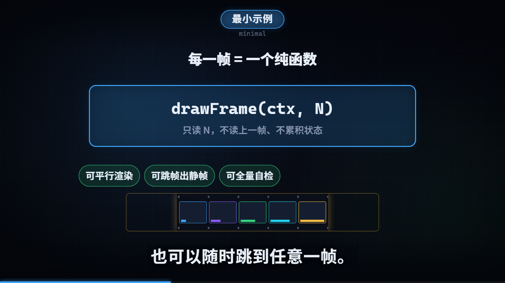
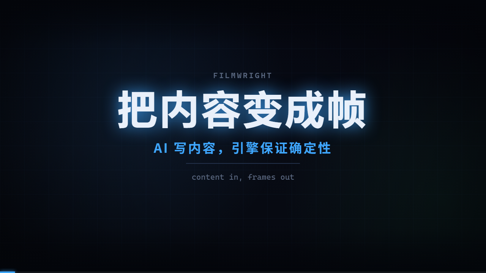

# filmwright

[](https://github.com/hongweifei/filmwright/actions/workflows/ci.yml)

在 Canvas 2D 上**逐帧绘制**的中文说明片渲染框架，专为 **AI 自动化视频制作**设计：AI 写内容与节拍（`scene.json`），引擎负责节奏与确定性。Chrome + CDP 逐帧截图 → ffmpeg。

**运行时零依赖**：浏览器里跑的渲染层不 import 任何 npm 包；宿主工具链除 MCP 服务外零依赖。只要有 Node 22+、一个 Chrome/Chromium/Edge、以及 ffmpeg，就能把一份解说词变成一条成片。



*`examples/minimal` 第 470 帧：HUD、章节主色、字幕与画面都由引擎内建件与镜头协同画出。*



*`examples/promo`——filmwright 自己的介绍片，全程 `scene.json` 驱动、零镜头代码，制作用的就是它自己的工具链（[狗粮](docs/scene.md)）。*

## 核心约定

**第 N 帧只是 N 的函数** —— 不读上一帧、不累积状态。这一条买来三件事：

| 买到什么 | 为什么 |
|---|---|
| **可平行渲染** | 每片区间独立，同时开几个浏览器实例，速度按片数上升 |
| **可跳帧** | 任意帧随时出静帧，QC 才可能做 |
| **可全量自检** | 不截图、只跑绘制，几秒把几千帧全过一遍查抛错 |

时间轴由**解说词唯一生成**：改一句词，重新合成那一句（逐句缓存），帧号自动跟着变，镜头不用改帧号。

## 你写什么、引擎给你什么

你只写三样：**配置**（`film.config.mjs`）、**解说词**（`script/narration.txt`）、**画面**——要么填声明式的 `scene.json`（13 类模板镜头，AI 的主干道），要么写 `shots/index.js`（手写镜头的逃生舱）。

引擎给你：字幕、章节卡、HUD、进度条、片尾、模板的节奏（入场错峰、停留呼吸、配色、缩放）、分片并行渲染、逐帧自检与画质自检、像素回归守卫、可拖动可热重载的预览页。

## 快速开始

需要 Node ≥ 22、Chrome/Chromium/Edge、ffmpeg；要配音再加 Python 3 + `edge-tts` + `numpy`。

```bash
git clone https://github.com/hongweifei/filmwright filmwright && cd filmwright
pip install edge-tts numpy          # 要配音时

node bin/filmwright.mjs tts    --project examples/minimal   # 解说词 -> 配音 + 时间轴
node bin/filmwright.mjs check  --project examples/minimal   # 九道自检
node bin/filmwright.mjs all    --project examples/minimal --shards 3
# -> examples/minimal/renders/minimal.mp4
```

改镜头时的主力回路是预览页（拖动 / 播放 / 改文件热重载）：

```bash
node bin/filmwright.mjs preview --project examples/minimal
```

## 命令

| 命令 | 作用 |
|---|---|
| `new` | 新建项目骨架（scene / shots 模板），目录非空直接拒绝 |
| `schema` | 输出 scene 规格的机器可读 schema（13 类模板 / 字段 / 上限 / 错误码） |
| `mcp` | MCP 服务器（stdio），把整条工具链暴露给 agent |
| `check` | 九道自检：导出、模块路径、时间轴引用、场景规格、素材、主题键、全帧绘制、画质（明细见[质量保障](docs/qc.md)） |
| `preview` | 预览页：拖动时间轴 / 播放 / 热重载（SSE 推送，不是轮询） |
| `tts` | 解说词 → `audio.wav` + `timeline.json`（逐句缓存） |
| `stills` | `--frames 40,470` 出静帧 |
| `sheet` | 抽帧联络表（人工 QC） |
| `render` | `[--shards N]` 逐帧渲染，分片并行 |
| `mux` | 画面与配音合流 |
| `srt` | 导出外挂字幕（SRT），可合成双语轨 |
| `all` | 一条龙：check → render → mux |

全部选项与产物落点见[命令参考](docs/cli.md)。

## 文档

| 文档 | 给谁看 |
|---|---|
| [入门](docs/getting-started.md) | 装环境、跑通示例 |
| [教程](docs/tutorial.md) | 从零做一个片子的完整流程 |
| [场景规格](docs/scene.md) | `scene.json`：AI/模板路线的入口，声明内容即出画面 |
| [AI / agent 接入](docs/ai.md) | MCP 服务器、`--json` 契约、推荐工作回路、错误码速查 |
| [狗粮记录](docs/dogfood.md) | 用 filmwright 做它自己的介绍片：暴露的问题与「模板不够用」清单 |
| [配置参考](docs/config.md) | `film.config.mjs` 全部字段与校验规则 |
| [API 参考](docs/api.md) | 镜头里能 import 的一切 |
| [命令参考](docs/cli.md) | 八个命令的全部选项 |
| [架构](docs/architecture.md) | 三层结构、核心不变量、设计决策 |
| [质量保障](docs/qc.md) | 自检、像素回归、验证夹具 |
| [FAQ](docs/faq.md) | 报错与「为什么」类问题 |
| [LIMITATIONS](LIMITATIONS.md) | **明确不做什么**——用之前先读 |

## 一个项目的形状

```
my-film/
  film.config.mjs        配置（default 导出）
  script/narration.txt   解说词
  script/timeline.json   tts 生成，渲染读它
  shots/index.js         导出 SHOTS（每个镜头只声明 start，区间由引擎串接）
  public/fonts/…         字体
  public/assets/…        素材与配音

  .work/                 中间产物，可随时删（重跑就有）
  renders/               成片，要留
```

## 质量网

- `npm test` —— 72 个单元测试，纯函数、零依赖，秒级；
- `filmwright check` —— 九道自检，`--static-only` 七道不启浏览器；画质自检带负面对照（故意做坏，证明真的会报）；
- `tools/regression.mjs` —— 像素回归：纯结构改动必须逐字节复现基准，改一个像素都不算重构。

细节见[质量保障](docs/qc.md)。CI 在 GitHub Actions 上分「静态 / 渲染」两个 job 跑同一套。

## 状态与参与

- 版本 0.x：核心管线完整、示例可复现，但**只在 Windows 上实测过**，API 还在 0.x 语义下演进。
- 明确不做的（视频素材、富文本排版、外挂字幕……）与原因见 [LIMITATIONS](LIMITATIONS.md)。
- 欢迎报告问题与贡献：见 [CONTRIBUTING](CONTRIBUTING.md)（含提交规范与验证纪律）。

## 许可

MIT，见 [LICENSE](LICENSE)。`examples/minimal/public/fonts/` 下的四款字体按各自许可分发（SIL OFL 1.1），见该目录的 `LICENSE.md`。
